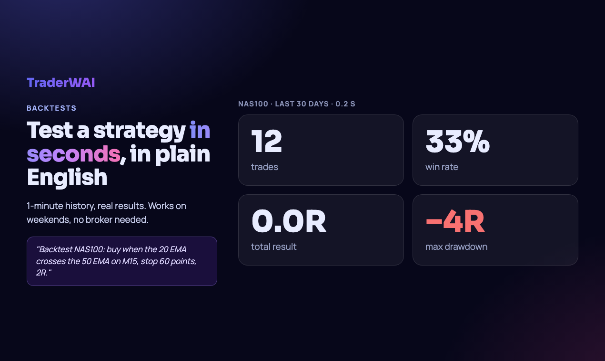
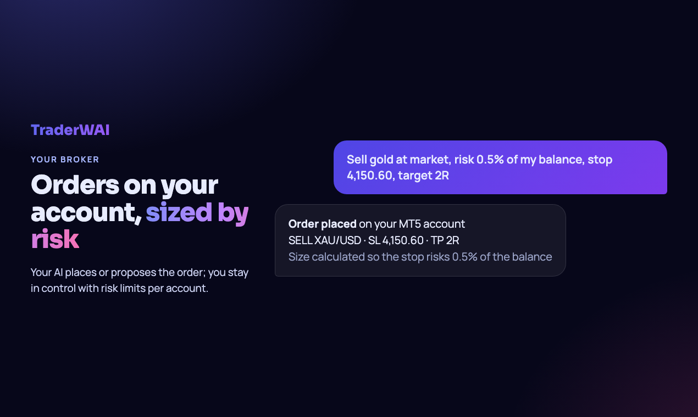

<p align="center"></p>

<h1 align="center">TraderWAI · MCP server</h1>

<p align="center"><b>Backtest, automate and trade from ChatGPT, Claude or Grok.</b><br>
A remote MCP server that connects the AI you already use to your own trading account.</p>

<p align="center">
<a href="https://traderwai.com">Website</a> ·
<a href="https://traderwai.com/en/docs">Docs</a> ·
<a href="https://traderwai.com/en/connect">Setup guides</a> ·
<a href="https://www.producthunt.com/products/traderwai">Product Hunt</a>
</p>

---

**Server URL:** `https://mcp.traderwai.com` (Streamable HTTP, OAuth 2.1 with dynamic client registration)
**Registry:** `com.traderwai/traderwai` in the [official MCP Registry](https://registry.modelcontextprotocol.io)

> This repository is the public listing for the hosted TraderWAI MCP server: connection instructions, tool list and assets. The server itself is a hosted service; there is nothing to install or run locally.

## What your AI can do with it

- **Read live charts** for forex, gold, indices, oil and crypto, on any timeframe from M1 to D1.
- **Draw its analysis on the chart**: levels, zones, structure, Fibonacci and the trade idea, rendered on real candles.
- **Backtest a strategy in plain English** on 1-minute history and get every trade, the win rate, the total in R and the drawdown in seconds.
- **Place orders on your own broker account**, sized by the risk you choose, with stop loss and take profit. You approve, or you set the rules.
- **Leave rules running**: conditional orders and exit rules (break-even, close on a structure break) checked every minute on your broker's own price, even with the chat closed.


## Supported platforms

MetaTrader 4 and 5, cTrader, TradeLocker, Match-Trader, DXtrade, Capital.com (beta), Binance and Bybit. Demo and live accounts, including prop-firm accounts.

## Connect it

You need a free TraderWAI account ([sign up](https://traderwai.com)); the first connection opens a login and consent screen.

| AI | How |
|---|---|
| **Claude** (web, desktop, mobile) | Settings → Connectors → Add custom connector → URL `https://mcp.traderwai.com` |
| **ChatGPT** | Settings → Apps & Connectors → Advanced → Developer mode → Create → URL `https://mcp.traderwai.com`, authentication OAuth |
| **Grok** | grok.com/connectors → New connector → Custom → URL `https://mcp.traderwai.com` |
| **Perplexity** | Settings → Connectors → Add custom remote connector → URL `https://mcp.traderwai.com` |
| **Claude Code** | `claude mcp add --transport http traderwai https://mcp.traderwai.com` |
| **Cursor / VS Code / Cline / any MCP client** | Add a remote (HTTP) server with the URL above, or use the JSON below |

```json
{
  "mcpServers": {
    "traderwai": {
      "url": "https://mcp.traderwai.com"
    }
  }
}
```

Step-by-step guides with screenshots for every AI and platform: [traderwai.com/en/connect](https://traderwai.com/en/connect).

## Try it

After connecting, ask your AI for example:

- *"Show me gold on H1 and draw the key levels and your trade idea on the chart."*
- *"Backtest gold for the last 30 days: buy when the price drops below yesterday's low and comes back up, stop just under the dip, target 2R."*
- *"Sell 0.10 gold at market, risk 0.5% of my balance, stop above the last swing high, target 2R."*
- *"On my NAS100 long: move the stop to break-even at +1R and close it if there is a bearish CHoCH on M15."*



## Tools

| Area | Tools |
|---|---|
| Market data and charts | `get_chart`, `draw_chart`, `get_ohlc`, `get_quote`, `list_symbols`, `list_timeframes` |
| Backtesting | `backtest_strategy` |
| Accounts | `get_account_info`, `get_broker_accounts`, `get_broker_account_state`, `create_broker_account`, `update_broker_account`, `delete_broker_account`, `test_broker_account`, `connect_ctrader`, `get_account_groups`, `set_account_group`, `delete_account_group` |
| Orders and positions | `execute_trade`, `execute_trade_multi`, `get_positions`, `modify_position`, `close_position`, `modify_broker_order`, `cancel_broker_order`, `get_trade_results` |
| Suggested orders | `suggest_order`, `get_suggested_orders`, `cancel_suggested_order` |
| Conditional orders and exit rules | `create_conditional_order`, `get_conditional_orders`, `get_conditional_order`, `update_conditional_order`, `run_conditional_order`, `cancel_conditional_order`, `delete_conditional_order` |
| Automation and risk | `get_auto_execution_config`, `set_auto_execution_config`, `delete_auto_execution_config`, `set_global_auto_execution`, `get_risk_limits` |
| Plan | `get_upgrade_url` |

Every tool carries MCP annotations (`readOnlyHint` / `destructiveHint`), so your AI client can ask for confirmation before anything that changes your account.



## Security

- OAuth 2.1 with PKCE and dynamic client registration; you can revoke access from your TraderWAI dashboard at any time.
- Broker credentials are encrypted at rest and never shared with the AI.
- Risk limits per account (max risk per order, daily loss, max open positions) are enforced by TraderWAI, not by the AI.
- [Privacy policy](https://traderwai.com/en/privacy) · [Terms](https://traderwai.com/en/terms)

## Plans

Charts, analysis and backtests are free. Paid plans add more executions, auto-execution, more conditional orders and MetaTrader accounts. See [pricing](https://traderwai.com/en/pricing).

## Support

[traderwai.com/en/contact](https://traderwai.com/en/contact) · info@traderwai.com

---

<sub>Trading leveraged products such as CFDs, forex and futures carries a high risk of losing money. TraderWAI is a technology tool: it does not provide investment advice or manage funds, and analyses or proposals from the AI are not recommendations. Past results, including backtests, do not guarantee future results. TraderWAI is operated by FLEXIN AGILE LTD (England and Wales, 16134800).</sub>
